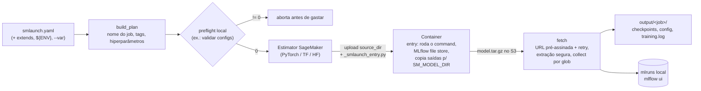

# smlaunch: treinos de ML na AWS SageMaker a partir de um YAML

`smlaunch` é uma CLI que padroniza o ciclo completo de um treino na AWS SageMaker:

1. valida as configs localmente;
2. lança o job;
3. acompanha a execução;
4. baixa os artefatos;
5. importa os runs no MLflow local;
6. confere se sobrou algum recurso gerando custo.

Ele nasceu do pipeline de treino de um projeto de P&D em otimização de rotas, o [QGAT](https://github.com/marcosreballo-source/quantum-routing-research/tree/main/qgat), em que dezenas de ablações precisavam rodar em GPUs na nuvem com custo rastreável. Depois foi extraído como um framework independente de projeto. O treino em si continua sendo só um `command` que o seu projeto já sabe rodar.

```bash
smlaunch launch --dry-run                     # mostra o plano e roda o preflight, sem tocar na AWS
smlaunch launch --var experiment=ablacao_ffn  # lança, transmite os logs, baixa tudo ao final
smlaunch launch --no-wait --spot              # lança em spot e libera o terminal
smlaunch wait                                 # retoma depois (usa o último job lançado)
smlaunch status | list | fetch <job>
smlaunch audit                                # endpoints, notebooks, EC2 e jobs ainda ativos (exit 3 se houver)
smlaunch cost --tag Project                   # gasto do mês por serviço e por tag, com previsão
```

## Como funciona



- **Entry point sem dependências.** O launcher coloca um `_smlaunch_entry.py` (só biblioteca padrão) no `source_dir` durante o upload e remove depois. O container não precisa ter o smlaunch instalado. O código de saída do treino é propagado, então um treino que falha aparece como `Failed` na AWS.
- **Sem credenciais no código.** A sessão usa a cadeia padrão do boto3 (env, perfil, SSO ou role). ARNs entram por `${VAR}` no YAML.
- **Custo à vista.** As tags de custo aceitam variáveis. O `status` estima o custo pelo tempo faturável, o `audit` acha recursos esquecidos e o `cost` consulta o Cost Explorer, agrupando por serviço e por tag.
- **Robustez no download.** O download usa streaming com retry, incluindo o 307 regional do S3, e escrita atômica. A extração do tar recusa path traversal, caminhos absolutos e links.
- **Nome de job configurável.** O nome pode vir de um template (`{project}-{experiment}`) ou de um hook `modulo:funcao` para regras próprias, e respeita o limite de 39 caracteres do SageMaker. O QGAT usa um hook que codifica método, baseline, critic e topologia quântica no nome.

## Instalação

```bash
pip install "smlaunch[sagemaker] @ git+https://github.com/marcosreballo-source/sagemaker-training-launcher"
cp examples/smlaunch.yaml ./smlaunch.yaml   # e ajuste
export SAGEMAKER_ROLE_ARN=arn:aws:iam::<conta>:role/<role>
```

O arquivo comentado em [`examples/smlaunch.yaml`](examples/smlaunch.yaml) mostra todas as opções.

## Testes

```bash
pip install -e ".[dev]" && pytest
```

São 29 testes, todos sem acesso à AWS: os clientes são substituídos por fakes. Eles cobrem config (`extends`, `${ENV}`, validação, chaves desconhecidas), nome e tags, plano e spot, lançamento com estimator falso, backoff do `wait`, paginação dos logs do CloudWatch, extração segura, coleta de artefatos e merge do MLflow. Há também um teste ponta a ponta do entry point, que executa um treino real num subprocesso e confere a propagação do código de saída.

## Licença

MIT
